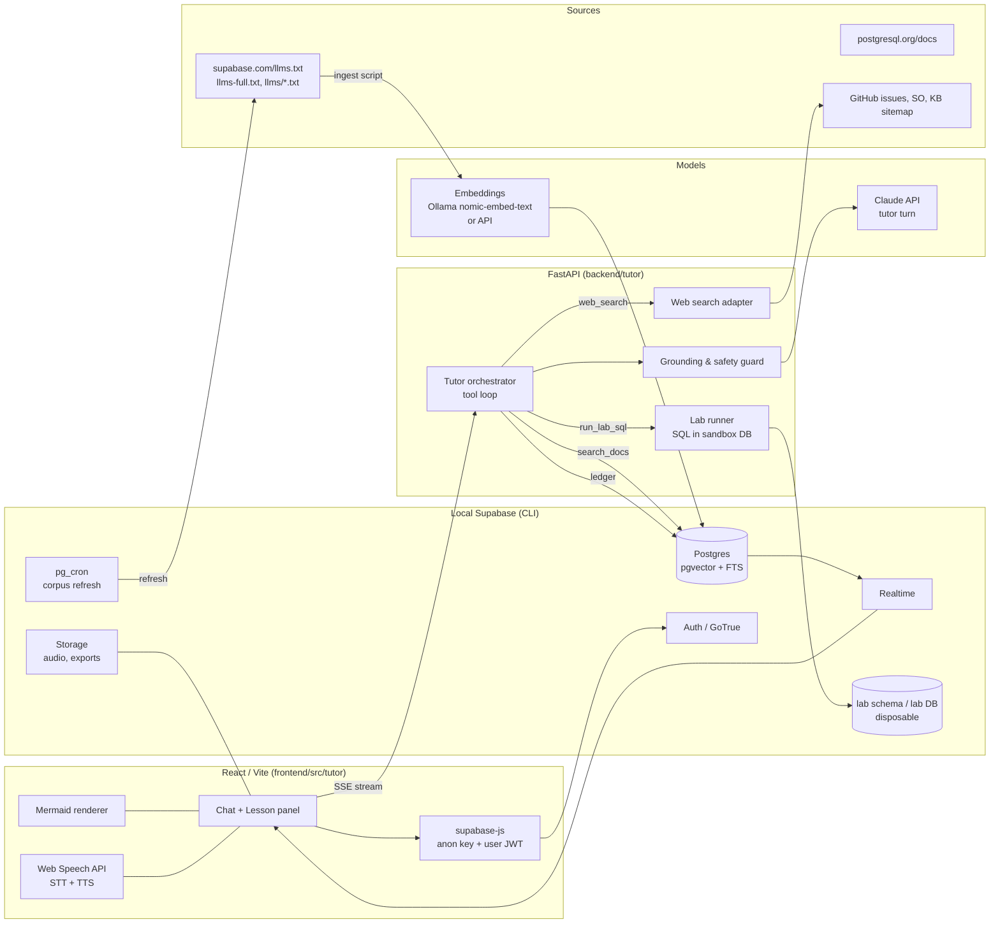

# Architecture

## 1. Goals and constraints

- **Local-first, low cost.** Everything runs on one MacBook Pro (M4 Pro, 48 GB). Hosted
  Supabase is Phase 3, not a prerequisite.
- **Grounded.** Answers cite Tier-1 Supabase docs (from the `llms.txt` corpus) first,
  PostgreSQL docs second, community evidence last and labelled as such.
- **Socratic.** The model never answers a lesson question directly by default; it follows
  the 10-step cycle in `prompts/kaenguru_master_instructions.md`.
- **Dogfooding.** The backend *is* Supabase (Postgres, pgvector, Auth, Storage, Realtime,
  pg_cron). Learning the stack and building on it are the same activity.
- **Hybrid LLM.** Cheap/local for embeddings, summarisation, TTS/STT; API model
  (Claude) for the tutor reasoning turn.
- **Mountable.** Runs standalone or as a sub-module of the AuDHS Tutor
  (FastAPI + React/Vite + Tailwind).

## 2. Component map



## 3. Request lifecycle (one tutor turn)

```mermaid
sequenceDiagram
  participant L as Learner (browser)
  participant A as FastAPI /tutor/turn
  participant C as Claude (tool loop)
  participant S as Postgres (docs_chunk, ledger)
  participant W as Web search
  participant X as Lab DB

  L->>A: POST message (JWT, session_id, mode, voice=on/off)
  A->>S: load session, last N turns, mastery ledger, lesson state
  A->>C: system prompt (persona+manual+mode) + context + tools
  loop tool calls
    C-->>A: search_docs(query, source_filter)
    A->>S: hybrid_search() → chunks + URLs + fetched_at
    A-->>C: results
    C-->>A: web_search(query)  (only if freshness/community needed)
    A->>W: search → results (dated, labelled tier)
    A-->>C: results
    C-->>A: run_lab_sql(sql, role, claims)
    A->>X: SET ROLE … ; run inside SAVEPOINT; capture SQLSTATE/plan
    A-->>C: rows / error / EXPLAIN
  end
  C-->>A: final turn (TutorTurn JSON: text, citations, mermaid[], question, ledger_delta)
  A->>S: persist turn + citations + ledger delta
  A-->>L: SSE stream (text tokens, then structured blocks)
  L->>L: render Mermaid; TTS speaks `speech` field if voice on
```

Key properties:

- **Structured output.** The model returns `TutorTurn` (see `prompts/tutor_output_schema.md`):
  `speech` (short, persona voice, for TTS), `text` (full markdown), `diagrams[]`
  (Mermaid), `citations[]` (URL + tier + fetched_at), `next_question` (exactly one),
  `ledger_delta[]` (topic, score, evidence), `mode`.
- **Guard.** Before sending to the learner, the guard checks: every factual claim
  marked `cite` has a citation; no `service_role` key in snippets; no destructive SQL
  without a warning block; incident mode has the incident-model headings.
- **Lab runner.** Executes SQL only against the lab database/schema, as the role the
  tutor asked for (`anon`, `authenticated`, `postgres`), with
  `request.jwt.claims` set, inside a transaction with `SAVEPOINT` so a broken lab can
  be inspected and rolled back. Returns rows, SQLSTATE, and optionally
  `EXPLAIN (ANALYZE, BUFFERS)`.

## 4. RAG pipeline

```mermaid
flowchart TD
  A[llms.txt index] --> B{for each URL}
  B --> C[llms-full.txt<br/>llms/js.txt, cli.txt, server.txt, api.txt<br/>guides/*.md, pricing.md, kb sitemap]
  C --> D[Split on H1/H2/H3<br/>target 400–900 tokens, 80 overlap<br/>keep heading path + code fences intact]
  D --> E[Embed<br/>nomic-embed-text 768d local<br/>or text-embedding-3-small]
  E --> F[(docs_chunk<br/>embedding vector + tsvector + metadata)]
  F --> G[hybrid_search()<br/>RRF of cosine + ts_rank_cd]
  G --> H[Rerank top 30 → 8<br/>optional, bge-reranker local]
  H --> I[Tool result with url#heading, tier, fetched_at]
```

Freshness: every chunk stores `source_url`, `fetched_at`, `content_hash`. A pg_cron job
(or `make refresh`) re-fetches `llms.txt`; changed documents are re-chunked, unchanged
ones are skipped by hash. The tutor reports `fetched_at` whenever it cites.

Web search is a *tool the model must justify*: the system prompt only permits it for
pricing/limits/versions/current bugs/community cases, or when `search_docs` returns
nothing relevant above a score threshold.

## 5. Teaching state

- `session` — one learning session (objective, mode, persona on/off, language).
- `turn` — every message both directions, with `TutorTurn` JSON for assistant turns.
- `mastery_ledger` — topic × score (0–5) × evidence × last_reviewed; spaced review
  picks the next weakest topic.
- `lab_run` — which lab, started/finished, learner hypotheses, test chosen, outcome.
- `citation` — per-turn citations, so evals can check grounding later.

## 6. Voice

- **Phase 1:** browser-only. Web Speech API `SpeechRecognition` (STT, de-DE/en-US by
  session language) and `speechSynthesis` (TTS) — zero cost, no keys.
- **Phase 2:** optional server TTS for a consistent kangaroo voice (local
  Piper/Kokoro via `backend/tutor/voice.py`; API TTS as a switch), audio cached in
  Supabase Storage keyed by `sha256(speech_text + voice)`.
- The model writes `speech` separately from `text`: short, no code, no URLs, no
  Mermaid, persona voice. `text` is what gets rendered.

## 7. Visualisation

Mermaid in the chat panel (sequence, flowchart, erDiagram, xychart). The renderer
sanitises and falls back to the raw block in a code fence if Mermaid fails to parse.
Tables for comparisons. `EXPLAIN` output is shown both raw and as a tree.

## 8. Standalone vs sub-module

| Concern | Standalone | AuDHS Tutor sub-module |
|---|---|---|
| Backend | `uvicorn backend.main:app` | `from kaenguru_tutor import build_service, router`; `include_router(router, prefix="/api/kaenguru")` |
| Frontend | Vite app at `/` | `<TutorApp host={{ userId }} apiBase="/api/kaenguru" />` inside the host shell |
| Auth | Supabase Auth (local), JWT per request | `HostVerifier`: the host vouches for its learner, mapped to one Supabase user; RLS still applies |
| Accounting | — | Host hooks: `before_turn` may refuse (503), `on_model_call` gets every API call with usage |
| Delivery | Socratic default | Per-session choice, explicit default (`deliveryChoice`) |
| DB | Local Supabase project in this repo | Same local Supabase project, `tutor` schema |
| Config | `.env` | Host app config + `TUTOR_*` keys |

The code must not import anything from the host app; the host imports only from `kaenguru_tutor`
(editable path dependency). AuDHS details and the open ADR: `docs/INTEGRATION-AUDHS.md`.

## 9. Security boundaries

- `service_role` only in FastAPI env; browser uses the publishable/anon key + user JWT.
- Lab DB is a separate local database (`lab`) or, minimum, a separate schema with its
  own roles; the runner refuses statements matching `DROP DATABASE|ALTER SYSTEM|pg_read_file|COPY .* PROGRAM`.
- Web search results are untrusted data; the model is told so and the guard strips
  instructions found inside them.
- Learner-pasted logs are stored only in the session and can be purged.

## 10. Local resource budget (M4 Pro, 48 GB)

| Component | RAM | Notes |
|---|---|---|
| Supabase CLI stack | ~2–3 GB | Postgres, GoTrue, PostgREST, Realtime, Storage, Studio |
| Ollama `nomic-embed-text` | ~0.5 GB | only during ingest/refresh |
| Optional reranker | ~1 GB | on demand |
| FastAPI + Vite | <0.5 GB | |

Claude API usage per tutor turn is the only recurring cost; embeddings and voice are free in Phase 1.
