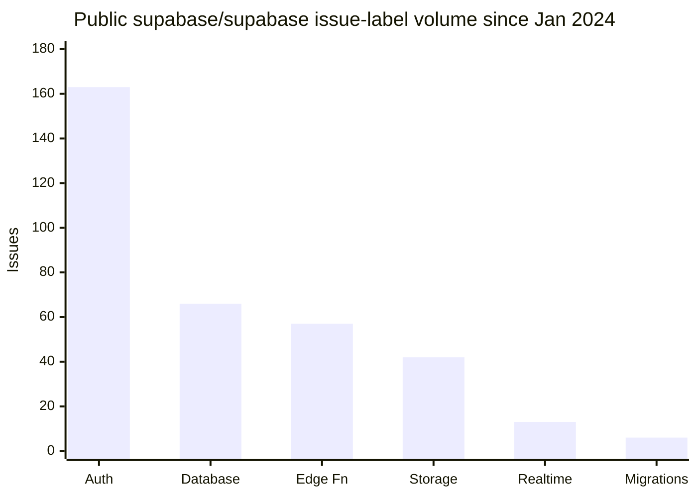
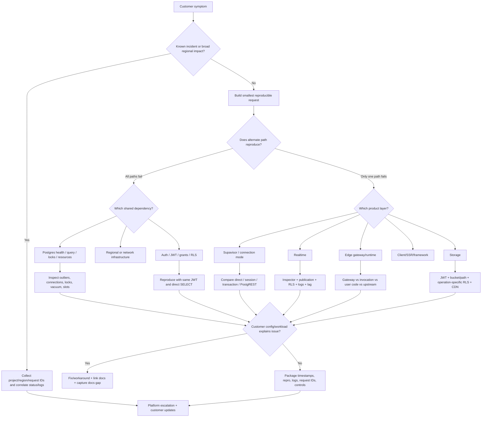
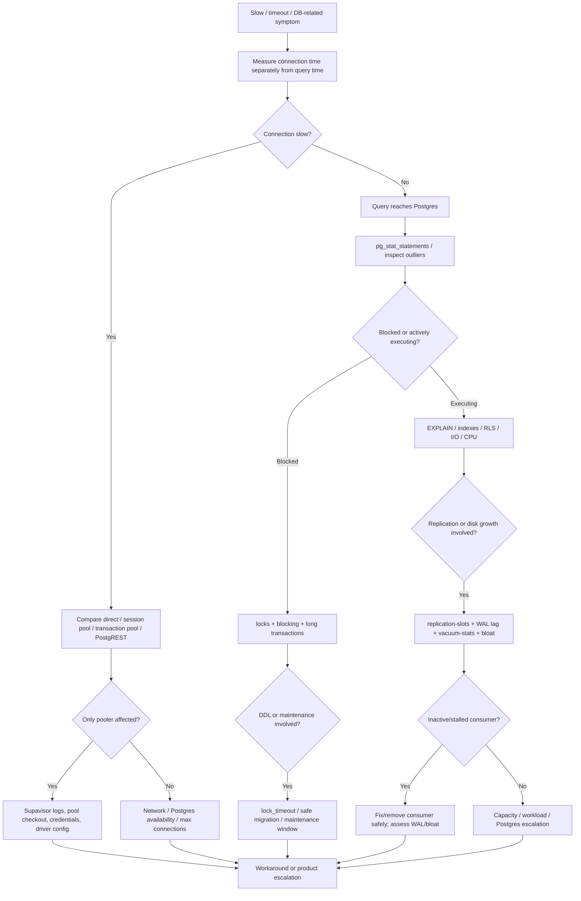

# Supabase Support Problem Landscape and Documentation Gap Analysis

## Executive summary

The most important finding for you as a Support Engineer candidate is that **Supabase's likely support workload is not dominated by obscure PostgreSQL internals**. The recurring front line is more likely to be a mixture of **Auth/RLS/session-state problems, database performance and connection management, Realtime authorization/delivery problems, Storage RLS failures, and Edge Function runtime/gateway issues**. Deep PostgreSQL topics such as WAL retention, autovacuum stalls, table bloat, replication slots, restore failures, and dangerous migrations are less likely to be the majority of tickets, but they are substantially more consequential when they occur and align closely with the separate Database Support Engineer role. This interpretation is consistent with Supabase's current role structure and its published support model. citeturn15search0turn16view2turn19search1

Supabase's documentation in October 2026 is **considerably better than I expected before doing this research**. In particular, the company has recently added highly operational troubleshooting material for Realtime, Edge Functions, Storage, database observability, replication, and Auth. Several troubleshooting pages were edited as recently as **October 21, 2026**. For example, the current Realtime guide explicitly says that RLS is the *“single biggest source of ‘silently missing’ events”* and walks through publication membership, RLS, replica identity, subscription configuration, logs, and network checks in a sensible diagnostic order. citeturn16view3turn10search10

The remaining weakness is therefore less **“Supabase has no documentation”** and more **“the right pieces exist, but the user has to know which layer is actually failing.”** A complaint such as *“Supabase randomly times out”* could originate in the client library, CDN/gateway, Auth, PostgREST, Supavisor, PostgreSQL connection saturation, a slow query, RLS, a lock, Edge runtime, or an actual regional/platform problem. Current documentation often explains each component well, but there is still room for better **symptom-first, cross-product runbooks** that isolate those layers. The September 2026 GitHub report in which both Supavisor poolers occasionally required **12–93 seconds** to connect while PostgREST against the same database stayed around a **0.35-second median** is an excellent example: a generic “optimize your queries” answer would have been completely wrong. citeturn13search3turn18search0

The documentation gaps with the highest practical value, in my assessment, are:

| Area | Probable support frequency | Impact when serious | Current docs | Documentation-improvement priority |
|---|---|---:|---|---|
| Auth, sessions, JWTs, RLS | Very high | High | **Good, but fragmented** | **High** |
| Query performance / timeouts | Very high | Critical | **Good** | **High** |
| Connection pooling / Supavisor | High | Critical | **Good, some legacy inconsistency** | **High** |
| Realtime missing/late events | High | High | **Very good, especially 2026 docs** | Medium |
| Storage / RLS / uploads | High | High | **Good and improving** | **High** |
| Edge Functions | Medium–high | High | **Good** | Medium–high |
| Database migrations | Medium | Critical | **Workflow good; production-safety gap** | **High** |
| Backup / restore / PITR | Lower-frequency | Critical | **Good but operationally fragmented** | **High** |
| WAL / autovacuum / bloat | Lower for general support; high-value for DB support | Critical | **Technically good** | Medium–high |

These frequency labels are a research synthesis, **not internal Supabase ticket statistics**. Supabase does not publish a support-ticket category breakdown that I could find. Public GitHub data is useful only as a directional signal because labels overlap, labeling practices differ by product, many users go to support instead of GitHub, and some repositories maintain their own issues.

A reproducible query against the public `supabase/supabase` repository found, for issues created since January 1, 2024, **163 Auth-labeled issues, 66 Database-labeled issues, 57 Edge Functions issues, 42 Storage issues, 13 Realtime issues, and 6 Migrations issues**. fileciteturn2file0L1-L2 fileciteturn1file0L1-L2 fileciteturn5file0L1-L2 fileciteturn4file0L1-L2 fileciteturn3file0L1-L2 fileciteturn6file0L1-L2



**Do not read that chart as market share of support cases.** It is more useful as evidence that Auth and database problems generate a substantial amount of public troubleshooting activity than as a precise workload forecast.

For your career decision, the strongest takeaway is encouraging: **this looks like real technical support rather than mainly ticket routing**. Supabase's published Embedded Support model sends advanced tickets to support people specializing in products such as Auth, Storage, Realtime and Edge Functions, while the current Database Support Engineer description explicitly calls for reproducing bugs and diagnosing autovacuum, WAL growth, long transactions, bloat, migrations and query performance. citeturn16view2turn19search1

## Evidence and likely issue frequency

The public evidence points to three broad tiers of work.

**The first tier is application/platform-boundary troubleshooting.** A user can have a perfectly healthy PostgreSQL instance but still fail because the JWT reaching RLS is not the JWT they thought it was, an SSR cookie was not propagated, a Realtime subscription joined without permission to see rows, Storage's metadata operation requires an RLS permission the developer did not anticipate, or a serverless application created far too many database connections. Supabase's architecture deliberately integrates Database, Auth, Storage, Realtime and Functions, so the boundaries between those systems become support boundaries as well. citeturn11search16turn11search0turn16view3turn11search1turn18search0

**The second tier is genuine operational database troubleshooting.** Supabase now exposes CLI inspection for query outliers, high-call-count queries, locks, long-running transactions, replication slots, traffic profiles and vacuum statistics. That tooling is a good indication of the classes of incidents that users and support engineers are expected to diagnose. citeturn12search0turn12search6

**The third tier is platform failure or product bug.** This is important because a good support engineer must know when to stop telling the customer to optimize their code. Public 2026 reports include Supavisor connection stalls isolated from PostgREST, Realtime joins timing out inside `PostgresCdcRls.create_subscription`, intermittent Auth/database connectivity degradation, and Edge Function HTTP/2 responses being closed before a response was delivered. Those need strong reproduction and escalation rather than another generic configuration article. citeturn13search3turn13search6 fileciteturn3file0L1-L2 fileciteturn5file0L1-L2

One particularly revealing source is Supabase's April 25, 2024 article about its **SLA Buddy** support tooling. It says that Embedded Support handles advanced tickets tied to specific products and that even an engineer unable to resolve a case is expected to triage it and set expectations before escalating. The escalation mechanism at that time was deliberately aggressive for higher-tier customers. This is historical rather than a statement of current SLA policy, but it shows how Supabase thinks about support operations. citeturn16view2

That combination suggests a support workload where the valuable skill is not knowing every fix from memory. It is being able to answer:

> **Which layer is actually broken, what evidence proves that, and what is the cheapest test that falsifies my current hypothesis?**

That is very close to the style of troubleshooting used in strong Elastic support work.

## Issue-by-issue findings

### Database performance, latency and timeouts

**What users probably report.** “Queries suddenly became slow,” “the API intermittently takes seconds,” “I get 504/statement timeout,” “CPU is high,” or “everything works after refreshing.” The underlying causes can include poor plans or missing indexes, connection saturation, locks, long transactions, insufficient compute, I/O pressure, RLS policy cost, or an upstream pooler/network failure. Supabase's current docs cover EXPLAIN-based investigation, query optimization, `pg_stat_statements`, connection observability and configurable timeouts. citeturn10search1turn10search13turn10search17turn10search0turn11search10

There is real public evidence for intermittent behavior that cannot simply be explained by one slow SQL statement. A GitHub report from **April 4, 2024** describes very small requests occasionally taking extremely long while an immediate retry succeeds. More importantly, the September 2026 Supavisor report compared three paths against the same project and found the poolers occasionally taking tens of seconds while PostgREST remained fast. citeturn13search9turn13search3

**Typical reproduction / isolation sequence**

1. Reproduce the same logical operation via the application/API.
2. Run the underlying SQL directly or via an alternate path.
3. Compare direct/session-pooler/transaction-pooler/PostgREST latency where applicable.
4. Check query outliers, active long-running queries and locks.
5. Check connection counts, CPU, memory and I/O.
6. Correlate timestamps against Postgres, PostgREST, API gateway and Supavisor logs.
7. Only then decide whether the problem is SQL, capacity, pooling/networking or platform infrastructure. Supabase provides most of those observability primitives today. citeturn12search6turn10search16turn10search24

A useful support collection bundle would be:

```bash
supabase inspect db outliers --linked
supabase inspect db calls --linked
supabase inspect db long-running-queries --linked
supabase inspect db locks --linked
supabase inspect db blocking --linked
```

Those commands are documented by Supabase and derive their data from PostgreSQL runtime statistics. citeturn12search6

**Documentation quality: 4/5.** The technical ingredients are excellent. The weakness is that they are spread across Query Optimization, Debugging Performance, Timeouts, Connection Management, Reports, Inspect Database and ORM-specific guides. citeturn10search1turn10search0turn11search10turn12search0

**Recommended improvement: High priority.** Add one canonical **“Request is slow or timing out”** runbook beginning with a layer-isolation matrix:

| Observation | Most likely next branch |
|---|---|
| Direct SQL and API both slow | Query, lock, database resource pressure |
| Direct SQL fast, PostgREST slow | API/RLS/PostgREST layer |
| PostgREST fast, pooler slow | Supavisor / network / driver |
| One query slow everywhere | Plan/index/data distribution |
| All operations slow | Resource saturation or platform incident |
| Only a geographic client is affected | Network / region / edge path |

This article should link outward into the existing excellent specialist pages rather than duplicate them.

**Priority: High.**

### Connection pooling and Supavisor

This deserves its own category rather than being hidden under performance because it generates distinct errors: *max client connections*, checkout timeouts, prepared-statement failures, stale sockets in serverless environments, session-state surprises, and driver-specific behavior.

The current **Connect to your database** documentation is unusually practical. It distinguishes direct, shared session, shared transaction and dedicated transaction connections; explicitly recommends very small application-side pools for serverless workloads; explains that transaction mode does not preserve session state; and gives driver-specific prepared-statement settings. citeturn18search0turn18search6

For example, current guidance recommends an application-side maximum of one connection as a starting point for serverless Postgres.js deployments, because every warm serverless instance otherwise multiplies the library's internal pool. Prisma's dedicated troubleshooting page gives parallel guidance and explains `connection_limit`. citeturn18search0turn18search4

The public bug history also demonstrates why support cannot automatically blame customer pool sizing. On **July 21, 2026**, one report isolated approximately 30% of fresh transaction-mode pooler connections hanging for around 22 seconds while session mode remained reliable; logs showed Supavisor checkout/backend connection timeouts. On **September 4, 2026**, another customer produced paired measurements where both poolers intermittently took 12–93 seconds while PostgREST remained healthy. citeturn13search0turn13search3

**Typical reproduction**

```text
same client/network
    |
    +--> PostgREST request
    |
    +--> shared session pooler :5432 -> SELECT 1
    |
    +--> shared transaction pooler :6543 -> SELECT 1
    |
    +--> direct connection if available -> SELECT 1
```

Repeat enough times to expose intermittent failures; record connect time separately from query execution time. That distinction is essential.

**Documentation quality: 4/5.**

There is, however, a concrete documentation-consistency problem. A current troubleshooting page for **“prepared statement XXX already exists”** still describes the issue simply as a PgBouncer problem and tells users to use direct port 5432, while the main 2026 connection documentation correctly distinguishes **Supavisor transaction mode**, Supavisor session mode, dedicated PgBouncer and direct PostgreSQL. citeturn18search2turn18search0

That is exactly the sort of legacy page that can waste both customer and support time.

**Recommended improvement: High priority.** Replace older PgBouncer-centric articles with one maintained driver/mode compatibility matrix covering Postgres.js, node-postgres, Prisma, SQLAlchemy/asyncpg, psycopg, JDBC and common Rust drivers. Add a diagnostic section distinguishing:

`connection establishment` → `pool checkout` → `Postgres execution` → `result return`.

**Priority: High.**

### Auth, JWTs, SSR and Row Level Security

This is probably the largest broad support category.

There are multiple independent failure classes: wrong redirect URLs, stale or missing cookies, refresh-token behavior, server/browser client confusion, OAuth/PKCE configuration, RLS policies, grants, custom JWTs, database triggers on `auth.users`, provider problems, rate limits and genuine service degradation. Supabase has a broad Auth Troubleshooting index, dedicated JWT/session documentation, SSR guides and specific error pages. citeturn11search8turn11search12turn11search16turn11search19turn11search24

One non-obvious issue is that **authentication and authorization are separate diagnoses**. A user can be correctly signed in while `auth.uid()` or the effective JWT used by another service is not what the application expects. Supabase's service-role troubleshooting article explains that a user session can overwrite the client's default authorization header, which is why Supabase recommends a separate non-SSR service-role client for administrative operations. citeturn11search0

Another recurring source of confusion is the difference between SQL grants and RLS. Current RLS documentation explicitly warns that missing grants can cause a `42501` **before a policy even executes**. The dedicated `42501` troubleshooting article then separates column permissions from RLS failures. citeturn11search4turn11search17

Public examples demonstrate the difficulty. A May 19, 2025 GitHub issue reports `auth.getUser()` occasionally hanging after a previously authenticated browser had been inactive, while a February 2026 report describes `auth.uid()` and JWT claims being `NULL` despite an apparently authenticated client. citeturn14search5turn14search21

The community also repeatedly asks basic RLS questions years after the feature became central. A Stack Overflow Storage question about RLS/JWT failure has more than 10,000 views, and recent questions still report apparently correct policies returning `403`. citeturn14search2turn14search6

**Typical reproduction**

A strong Auth support runbook should collect:

```text
Browser or mobile app
        |
        v
Which token/session does the client believe it has?
        |
        v
Which Authorization header actually reaches Supabase?
        |
        +--> Auth rejects token -> authentication problem
        |
        +--> Auth accepts token
                |
                v
        Can equivalent SELECT see the row?
                |
                +--> no -> grants / RLS / claims
                |
                +--> yes -> product-specific layer
```

For SSR, add cookie propagation, browser-versus-server client construction and cache/proxy behavior. Current Supabase SSR guidance uses cookie-based session storage and separate browser/server clients. citeturn11search19turn11search22

**Documentation quality: 4/5.** There is a lot of high-quality material, but a developer has to understand enough about the architecture to choose the right article.

**Recommended improvement: High priority.** Build a canonical **Auth State Diagnostic Matrix** showing, for every client context:

| Context | Token source | Trusted identity call | Cookie owner | Common failure |
|---|---|---|---|---|
| Browser | local/cookie session | client Auth API | browser | expired/missing session |
| SSR server | request cookies | server Auth client | framework response | cookies not propagated |
| Service-role worker | server secret | dedicated admin client | none | user token overrides service role |
| Realtime | Realtime socket token | channel auth | client/socket | token not set/refreshed |
| Storage | request JWT | RLS on `storage.objects` | calling client | object policy mismatch |

Version the framework examples and prominently tag old/deprecated patterns in search results.

**Priority: High.**

### Realtime

This is the area where **current documentation is strongest**.

The Realtime Postgres Changes troubleshooting guide was last edited **October 21, 2026** and is structured almost like an internal support runbook. It calls silently missing events a common issue, instructs users to check publication membership first, then RLS, replica identity, subscription configuration, cleanup, logs and network conditions. It says RLS is the *“single biggest source of ‘silently missing’ events”*. citeturn16view3

Its reproduction strategy is particularly good: query the changed row using the **same credentials as the subscribing client**. If the client cannot select that row, Realtime correctly will not deliver it either. Merely receiving `SUBSCRIBED` proves the WebSocket joined, not that the user may observe a particular row. citeturn16view3

Additional docs cover Realtime Inspector/DevTools isolation, silent browser-background disconnections, heartbeats, quota errors and observability of replication/RLS bottlenecks. citeturn10search18turn10search8turn17search9turn17search23

Public community evidence matches those topics. A 2025 Stack Overflow question found custom-JWT/RLS behavior behind missing Realtime events, and another asks why ordinary database reads work while Realtime delivers nothing under a custom JWT. citeturn14search3turn14search7

There are also genuine infrastructure cases. A public issue opened **October 13, 2026** reports channels taking roughly 11–13 seconds to connect and approximately 30 seconds to join, with `TIMED_OUT`/`CHANNEL_ERROR` and an internal `PostgresCdcRls.create_subscription` timeout. fileciteturn3file0L1-L2

**Typical support reproduction**

```sql
select *
from pg_publication_tables
where pubname = 'supabase_realtime';
```

Then:

1. Use Realtime Inspector.
2. Test privileged/server-side behavior.
3. Test the actual authenticated role.
4. Perform a normal SELECT for the changed row with identical credentials.
5. Inspect browser WebSocket frames.
6. Inspect Realtime logs.
7. Check Reports for lag or RLS execution latency.
8. If all client configuration is eliminated and join latency itself is abnormal, escalate as a service/platform issue. citeturn16view3turn10search18turn17search23

**Documentation quality: 5/5 for the core “no event” path.**

**Remaining gap.** The troubleshooting directory is now large. I would consolidate it into three entry points:

`cannot join` / `joined but no events` / `connected then disconnects or falls behind`.

Also put delivery/durability expectations and the difference between Broadcast and Postgres Changes closer to the architectural overview. Supabase already recommends Broadcast for greater scalability/security while describing Postgres Changes as simpler but less scalable. citeturn17search11

**Priority: Medium**, because the current docs are already quite strong.

### Storage

The dominant support pattern appears to be **authorization and object-lifecycle semantics**, not S3 itself.

Supabase Storage defaults to RLS-controlled access through PostgreSQL metadata. Current docs provide a Storage troubleshooting directory and an error-code table, including `AccessDenied`, database errors and resource-lock conditions. citeturn11search9turn11search5

A particularly interesting troubleshooting page was edited **October 21, 2026**. It explains why an upload can report `403 new row violates row-level security policy` even when the developer believes INSERT permission is correct: Storage may need to return metadata for the newly inserted object, and that read can itself be denied. The page describes the failure as the database being unable to *“return the metadata for the newly created object.”* citeturn11search1

That is exactly the kind of behavior that generates support cases because the customer naturally reads the message as “INSERT is denied.”

The community evidence is substantial. Stack Overflow contains repeated versions of the same `storage.objects` RLS problem across several years, including an 11,000-view question and a 2025 case where the user's apparently valid INSERT policy still resulted in `400/403` behavior. citeturn14search2turn14search6turn14search10

Another likely source of tickets is perceived stale data after overwriting an object. Supabase's upload documentation explicitly advises using a **new object path** rather than overwriting because CDN propagation can temporarily serve stale content from edge nodes. citeturn17search0turn17search4

**Typical reproduction**

1. Confirm the client is actually authenticated and inspect the JWT.
2. Reproduce an ordinary database operation using the same user.
3. Verify bucket ID and object path.
4. Evaluate `INSERT`, `SELECT`, `UPDATE` and `DELETE` policy requirements separately.
5. Check Storage and Postgres logs.
6. Retry with a brand-new object name to distinguish RLS from CDN/upsert behavior.

**Documentation quality: 4/5.**

**Recommended improvement: High priority.** Add a Storage operation matrix such as:

| Operation | SQL/RLS rights potentially needed | Typical misleading symptom |
|---|---|---|
| Upload new object | INSERT; potentially readback access | “new row violates RLS” |
| Upsert | INSERT + UPDATE + read conditions | 403/400 |
| List | SELECT | empty bucket/list |
| Download private | SELECT / signed-token semantics | 403 |
| Delete | DELETE + path ownership logic | unauthorized |
| Replace same path | RLS plus CDN propagation | upload succeeds, old content appears |

Put that matrix directly in the Storage RLS guide, not just the troubleshooting index.

**Priority: High.**

### Edge Functions

Edge Function support requires separating at least four layers:

**gateway → worker startup/runtime → function code → downstream dependency.**

Supabase's current documentation already identifies many important status classes. The platform's general HTTP documentation describes project/API gateway timeouts and Edge Function resource-limit responses; the Functions-specific docs expose `sb-error-code` headers and troubleshooting for runtime conditions. citeturn10search7turn10search19turn10search3

The September 22, 2026 troubleshooting guide is particularly operational. It covers WebSocket workers being retired, hard wall-clock limits, CPU limits and patterns for moving long work into background/queued processing. citeturn17search1

The platform has also materially changed over time. A July 18, 2025 Supabase engineering post announced persistent S3-compatible storage and cold-start improvements of up to 97%, illustrating why older community advice about Edge Functions can age quickly. citeturn17search2

The most valuable public issue for support training is extremely recent: **October 18, 2026**. A user reproduced function-generated `4xx` responses disappearing over HTTP/2 while HTTP/1.1 consistently returned the expected response. Their comparison used `curl --http2` versus `curl --http1.1`, across two projects and both Supabase/custom domains. That is excellent support-quality isolation because it reduces the failure to a protocol/platform boundary rather than application business logic. fileciteturn5file0L1-L2

Another important distinction is platform-level JWT checking versus function code. Current Supabase troubleshooting explains that a built-in/legacy JWT verification step can reject a request **before the function executes**, meaning absence of function logs can itself be diagnostic evidence. citeturn10search32

**Typical reproduction**

```bash
curl -sv --http2   https://PROJECT.functions...
curl -sv --http1.1 https://PROJECT.functions...
```

Then compare:

```text
same request
   |
   +--> no invocation log
   |       -> gateway / auth / routing
   |
   +--> invocation starts but BOOT_ERROR
   |       -> imports / startup / config
   |
   +--> invocation starts and exceeds limits
   |       -> wall clock / CPU / memory
   |
   +--> invocation finishes but client fails
           -> gateway / network / protocol / response handling
```

Also reproduce locally where possible and isolate downstream Postgres or third-party API latency.

**Documentation quality: 4/5.**

**Recommended improvement: Medium–high priority.** Create one **Edge Request Lifecycle** diagram showing exactly where each status/error originates and what logs should exist at each layer. Include ready-to-copy `curl` commands for HTTP version, headers, timing and request IDs.

**Priority: Medium–high.**

### Database migrations and schema drift

Supabase has good workflow documentation for generating, applying, pulling and repairing migration history. The CLI also supports migration operations and schema diffing. citeturn11search2turn11search6

The weakness is **production DDL safety**, and this is not merely my speculation. An open documentation issue created **June 4, 2026** explicitly says the migrations guide mentions increasing `lock_timeout` after a lock timeout but does not tell users how to determine which locks a migration will take before deployment. The issue points to `CREATE INDEX` without `CONCURRENTLY`, type changes and other DDL as common production footguns. citeturn13search2

The official migrations page indeed says to consider increasing `lock_timeout` when a migration fails. That is reactive rather than preventive. citeturn11search2

Elsewhere, Supabase documentation already contains stronger safety guidance. The data-deletion guide explains that `DROP TABLE` takes `ACCESS EXCLUSIVE`, advises staging/backups/low-traffic windows, and recommends `lock_timeout` and `statement_timeout`. citeturn11search14

So the knowledge exists; **it is not integrated into the primary migration workflow**.

**Typical reproduction / preflight**

For a migration against a populated production table:

```text
migration SQL
     |
     v
What lock does each statement require?
     |
     +--> brief metadata lock -> controlled rollout
     |
     +--> long ACCESS EXCLUSIVE / table rewrite
              |
              +--> expand-contract?
              +--> CREATE INDEX CONCURRENTLY?
              +--> backfill in batches?
              +--> maintenance window?
```

Before applying it, inspect long-running transactions and blocking queries, because those can turn a normally brief lock acquisition into an outage. Supabase's CLI already exposes both. citeturn12search6

**Documentation quality: 3/5 for production safety; 4/5 for developer workflow.**

**Recommended improvement: High priority.** Add:

- a DDL lock-level reference;
- “safe versus dangerous on large tables” examples;
- expand/contract patterns;
- concurrent index creation;
- batched backfills;
- preflight lock inspection;
- migration canary/staging procedure;
- failure recovery and roll-forward guidance.

This would directly reduce high-severity support incidents.

**Priority: High.**

### Backups, PITR and restores

Supabase's backup documentation is reasonably detailed, but this is a category where a user often discovers a misunderstanding **during an emergency**, which raises the documentation quality bar.

Current docs state that Pro/Team/Enterprise projects receive managed backup capability; newer eligible database versions use physical backups, PITR can restore to a seconds-granularity point, and project downtime occurs during restoration. citeturn16view4

Several operational gotchas are particularly important:

- **Storage object contents are not part of the database backup**; only Storage metadata is in PostgreSQL. Restoring the database therefore does not resurrect an object that was deleted from object storage. citeturn16view4
- Custom-role passwords are not preserved in daily backups and may need resetting after a restore. citeturn16view4
- User-created subscriptions/replication slots generally need to be dropped before restoration and recreated afterwards; Supabase handles its Realtime slot separately. citeturn16view4
- PITR duration depends on factors including database size and how much WAL must be replayed. citeturn11search18

Public GitHub history shows a second problem: **logical-backup portability**. An issue opened **November 19, 2025** reports a logical backup containing PostgreSQL 17.6 `\restrict`/`\unrestrict` commands that could not be restored with PostgreSQL 15.8's `psql`, producing `invalid command \restrict`. citeturn13search1

A separate January 2026 restore issue reports trouble with logical dumps containing meta-command/cron-related content and explicitly asks why the documented manual procedure does not restore cleanly. citeturn13search4

That illustrates the distinction between:

**“a backup exists”** and **“we have proven this artifact can restore into the environment we expect.”**

**Documentation quality: 4/5 conceptually, 3/5 as an operational disaster-recovery runbook.**

**Recommended improvement: High priority.** Add a **Restore Readiness** guide with:

| Check | Before incident | After restore |
|---|---|---|
| PostgreSQL client/server version compatibility | Validate | Confirm |
| Database data | Test restore | Row-count/sanity checks |
| Auth users/config | Export dependencies | Login smoke test |
| Storage objects | Back up separately | Check object availability |
| Custom role passwords | Record procedure | Reset/test |
| Extensions | Inventory | Verify |
| Cron/webhooks | Inventory | Verify jobs |
| Realtime publications/slots | Inventory | Recreate/check |
| External replication | Record slots/subscriptions | Reinitialize/check lag |
| App secrets/config | Back up outside DB | Validate |
| Migration history | Export/check | Compare |

A quarterly documented restore test would be more useful than another paragraph explaining what a backup is.

**Priority: High.**

### WAL, replication slots, autovacuum and bloat

This category is the clearest boundary between a broad Support Engineer and the specialized Database Support Engineer.

The current Database Support role explicitly calls for deep understanding of **autovacuum behavior, WAL growth, long-running transactions and table bloat**, alongside migration recovery and performance tuning. citeturn19search1

Supabase's technical documentation is now quite strong here. `supabase inspect db` supports:

```bash
supabase inspect db bloat --linked
supabase inspect db vacuum-stats --linked
supabase inspect db replication-slots --linked
supabase inspect db long-running-queries --linked
```

The CLI documentation explains that replication-slot inspection shows slot activity and WAL lag, while long-running transactions can interfere with vacuum and DDL. citeturn12search6

The replication documentation correctly explains a key PostgreSQL operational fact: logical replication slots retain WAL until the consumer confirms it has processed it. Supabase also provides SQL for monitoring `active`, `wal_status`, `safe_wal_size` and retained WAL. citeturn12search2turn12search8

There is even a dedicated troubleshooting guide for a subtle scenario in which an inactive replication slot contributes to autovacuum being stalled while memory/maintenance symptoms grow. citeturn12search1

For bloat, current docs distinguish ordinary vacuuming from disk-space reclamation. `VACUUM FULL` rewrites the table and takes an `ACCESS EXCLUSIVE` lock; Supabase documents `pg_repack` as an online alternative for physical storage optimization. citeturn12search4turn12search9

The core escalation relationship is:

```text
consumer stalls
      |
      v
replication slot cannot advance
      |
      v
WAL retained / old state retained
      |
      +--> disk growth
      |
      +--> replication lag
      |
      +--> vacuum complications / tuple retention
                 |
                 v
              bloat
                 |
          +------+------+
          |             |
       I/O cost      table/index size
          |             |
          +------+------+
                 |
              latency
```

**Documentation quality: 4/5 technically.**

The biggest remaining gap is a clear **managed-service responsibility model**:

> What does Supabase automatically maintain, what should the customer monitor, what may the customer safely tune, and what requires Support?

For experienced PostgreSQL people, the current pages are usable. For an application developer, that ownership boundary is much less obvious.

**Recommended improvement: Medium–high priority.** Create a **Postgres Maintenance on Supabase** page with four columns:

`automatic` | `customer-controlled` | `dangerous without planning` | `contact Support`.

Include concrete alert thresholds or trend-based guidance for WAL retention, bloat, replication lag, long transactions and connection pressure wherever Supabase can responsibly define them.

**Priority: Medium–high overall; High for the Database Support organization.**

## Documentation quality and recurring gaps

Across the nine issue areas, I see five repeated documentation problems.

The first is **component-first information architecture versus symptom-first user behavior**. Supabase has excellent pages titled Connection Management, Realtime Reports, Database Timeouts, Inspect Database, Storage Error Codes, Auth Sessions and so on. A customer rarely opens a ticket saying, “I have a Supavisor checkout problem.” They say, “my production API sometimes takes 30 seconds.” The support engineer must translate the symptom into component hypotheses. citeturn10search0turn11search10turn17search23turn11search5

The second is **cross-product authorization complexity**. RLS touches ordinary Data API requests, Storage metadata, Realtime row visibility and sometimes what customers perceive as Auth problems. Current docs explain each case individually, but an end-to-end map of **JWT → role/grants → RLS → product-specific behavior** would eliminate many tickets. citeturn11search4turn11search1turn16view3turn11search0

The third is **legacy-content drift**. The clearest concrete example is the old prepared-statement/PgBouncer troubleshooting page versus the much richer modern Supavisor/direct/dedicated-pooler architecture. Community answers age even faster: older Stack Overflow guidance often references previous Dashboard locations or prior client-library approaches. citeturn18search2turn18search0turn14search15

The fourth is **insufficient distinction between customer misconfiguration and platform defects**. Good support documentation should not merely list common customer mistakes; it should state what evidence means the customer has probably ruled them out. The 2026 pooler and Edge HTTP/2 reports demonstrate how valuable paired-path comparisons can be. citeturn13search3 fileciteturn5file0L1-L2

The fifth is **operational readiness versus conceptual documentation**. Migrations and backups are the strongest examples. Documentation can correctly explain `db push`, daily backups and PITR while still leaving users underprepared for an `ACCESS EXCLUSIVE` lock incident or an emergency restore that exposes version or object-storage assumptions. citeturn11search2turn13search2turn16view4turn13search1

A useful quality scorecard is therefore:

| Issue | Findability | Technical depth | Reproduction guidance | “When to escalate” guidance | Overall |
|---|---:|---:|---:|---:|---:|
| Performance/timeouts | 3/5 | 5/5 | 4/5 | 3/5 | **4/5** |
| Pooling/Supavisor | 4/5 | 5/5 | 4/5 | 3/5 | **4/5** |
| Auth/RLS/SSR | 3/5 | 4/5 | 4/5 | 3/5 | **4/5** |
| Realtime | 5/5 | 5/5 | 5/5 | 4/5 | **5/5** |
| Storage | 4/5 | 4/5 | 4/5 | 3/5 | **4/5** |
| Edge Functions | 4/5 | 4/5 | 4/5 | 3/5 | **4/5** |
| Migrations | 4/5 | 3/5 production safety | 3/5 | 2/5 | **3/5** |
| Backup/restore | 4/5 | 4/5 | 3/5 | 3/5 | **4/5 conceptual / 3/5 runbook** |
| WAL/vacuum/bloat | 3/5 for newcomers | 5/5 | 4/5 | 3/5 | **4/5** |

Those scores are my assessment based on the current pages and the failure modes represented in public issues, not Supabase-provided ratings.

## Practical support runbooks and escalation flows

For a general Support Engineer, I would learn one universal triage pattern before memorizing product-specific fixes.



That approach matches Supabase's published philosophy that support should triage, reproduce and set expectations even when the eventual fix belongs to another team. Supabase's Embedded Support model exists specifically for advanced product-oriented tickets. citeturn16view2

For database-heavy cases, I would use a second flow.



The key diagnostic commands supporting that flow are already officially documented. citeturn12search6turn12search8

For interview preparation, I would be able to explain five concrete cases without notes:

| Interview-style case | Strong first hypothesis set |
|---|---|
| “Realtime says SUBSCRIBED but no updates arrive” | Publication → same-user SELECT/RLS → filter → token → logs/lag |
| “Vercel app intermittently exhausts DB connections” | Per-instance client pool → transaction mode → `connection_limit` / max=1 → pooler metrics |
| “Storage upload says RLS despite INSERT policy” | JWT → bucket/path → readback/SELECT policy → Storage/Postgres logs |
| “API got slow right after migration” | lock waits → long transactions → table rewrite → plan/index changes |
| “Database disk grows although table size seems stable” | WAL-retaining replication slot → dead tuples/bloat → long transaction/autovacuum |

Those scenarios line up exceptionally well with the current public docs and the Database Support Engineer specification. citeturn16view3turn18search4turn11search1turn13search2turn12search1turn19search1

## Documentation roadmap and implications for the support role

Assuming no organizational constraints, I would propose the following roadmap.

| Timeline | Deliverable | Primary owner | Partners | Expected support effect |
|---|---|---|---|---|
| **First month** | “Slow or timing out” cross-layer runbook | Support + Docs | Postgres, Platform/SRE | Fewer incorrect query-vs-pooler diagnoses |
| **First month** | Auth/JWT/RLS diagnostic matrix | Auth Docs | Support, Realtime, Storage | Fewer repetitive RLS/session tickets |
| **First month** | Storage CRUD/RLS permissions matrix | Storage Docs | Auth, Support | Reduce misleading upload 403 cases |
| **First month** | Audit/redirect legacy PgBouncer/Supavisor pages | Database Docs | Supavisor team | Remove contradictory connection advice |
| **Month two** | Edge request-lifecycle troubleshooting diagram | Functions Docs | Edge/Networking, Support | Faster gateway-vs-runtime isolation |
| **Month two** | Production-safe migration guide | Database Docs | Postgres Engineering | Prevent lock/rewrite outages |
| **Month two** | Restore Readiness + post-restore checklist | Platform Docs | Database Support, Storage, Auth | Reduce disaster-recovery surprises |
| **Month three** | PostgreSQL maintenance responsibility matrix | Database Support | Managed Postgres/SRE | Clarify autovacuum/WAL/bloat ownership |
| **Month three** | Canonical “support bundle” command | Support Tooling | Product engineering | Better first-response evidence |
| **Months three–six** | Automated docs freshness/deprecation checks | Docs Engineering | SDK/product teams | Reduce legacy instructions |
| **Months three–six** | Incident/issue → documentation review process | Support Operations | All product teams | Convert repeated tickets into permanent improvements |
| **Ongoing** | Quarterly restore exercises and runbook validation | SRE/Database Support | Platform | Validate DR rather than assume it |
| **Ongoing** | Measure failed docs searches and ticket deflection | Docs/Product Analytics | Support | Prioritize actual user pain |

The **support bundle** deserves special emphasis. Supabase already exposes enough observability to make this powerful. A one-command bundle could collect non-secret metadata such as project region/version, connection-mode configuration, high-level connection utilization, outliers, long-running transactions, lock chains, vacuum state and replication-slot lag, with explicit redaction before attachment. Existing `supabase inspect` capabilities provide much of the foundation. citeturn12search0turn12search6

For documentation maintenance, I would also attach a lightweight ownership rule to every troubleshooting page:

```text
Product owner
Docs owner
Last technically validated
Client/CLI versions tested
Supersedes / superseded by
Related error codes
Escalation criteria
```

That would directly address legacy pages such as the PgBouncer prepared-statement article without requiring support engineers to remember which search result is current. citeturn18search2turn18search0

### What this means for you as a candidate

The research actually makes the **general Support Engineer role more attractive technically** than the title alone might suggest.

Supabase currently has general Support Engineer and Database Support Engineer positions across multiple regions, and its published support architecture includes product-specific Embedded Support for advanced tickets. citeturn15search0turn16view2

I would expect the distinction to look approximately like this — this is an inference from the job descriptions and support model, not an internal Supabase org chart:

| General Support Engineer | Database Support Engineer |
|---|---|
| “Why does login work in browser but not SSR?” | “Why is autovacuum unable to keep up?” |
| “Why does RLS return empty rows?” | “Which long transaction is preventing cleanup?” |
| “Why does Storage return 403?” | “Why is WAL retention consuming disk?” |
| “Why am I missing Realtime events?” | “Which replication slot is holding WAL?” |
| “Why did my Edge Function return 546?” | “Why did this DDL migration block production?” |
| “Why do I have max-client errors?” | “Is this application pooling, Supavisor or Postgres saturation?” |
| Reproduce and isolate across products | Deep PostgreSQL root-cause analysis |
| Solve common configurations and known cases | Handle advanced/high-impact cases |
| Escalate strong reproductions to specialists/engineering | Escalate platform/Postgres defects with deep evidence |

The current Database Support Engineer description supports that interpretation: it explicitly calls for advanced investigation across Postgres, Auth, RLS, Storage, Realtime, Edge Functions and client libraries, with deep PostgreSQL knowledge including autovacuum, WAL, long-running transactions and bloat. citeturn19search1

For someone coming from **Elastic Support**, your strongest transferable skill is probably not a particular database command. It is the diagnostic discipline of distinguishing:

**application problem → configuration problem → resource/capacity problem → product bug → infrastructure incident.**

That is exactly what the Supabase problem landscape demands.

The areas I would study hardest before interviewing are, in order:

**PostgreSQL connection and transaction fundamentals**, including `pg_stat_activity`, locks, transactions, execution plans and pooler semantics; **RLS/JWT mechanics**; **Supabase Auth/SSR state flow**; **Realtime's publication/RLS/replication model**; and then **WAL, autovacuum, replication slots and bloat**. The first four are likely to make you effective quickly in the general role; the last group is what begins moving you toward Database Support.

Most importantly, I would no longer interpret the long-running support vacancies as evidence that the job consists of repeatedly answering poorly documented basic questions. **There is a large and technically rich support surface here, and Supabase is actively building documentation around it.** The open question for your decision is instead organizational: how much of a general Support Engineer's actual week is spent doing the interesting isolation work described above versus initial-response/queue work. Supabase's public material proves both activities exist, but it does not disclose their actual percentage. Its 2024 support article shows both rapid triage/escalation and advanced Embedded Support, while the current careers page shows the company hiring general and specialized support roles simultaneously. citeturn16view2turn15search0

That is the question I would make central in an interview:

> **“When a case moves beyond standard troubleshooting, how much ownership does the original Support Engineer retain through reproduction and root-cause isolation, and when does it move to Embedded Support, Database Support, or product engineering?”**

A strong answer would tell you considerably more about the technical quality of the role than the age of the job posting itself.